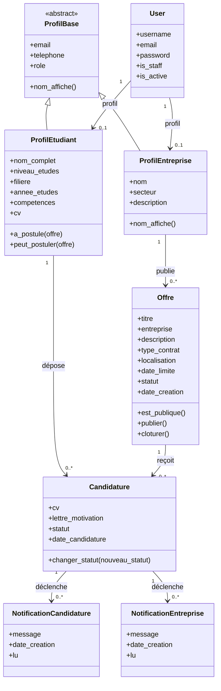

# Analyse des besoins et modélisation UML — Kaay Job

## 1. Contexte et objectif

Kaay Job est une plateforme web qui met en relation les étudiants à la recherche d'un stage ou d'un emploi et les entreprises qui publient des opportunités. Le personnel administratif assure la gestion et la modération de la plateforme.

## 2. Acteurs

- **Visiteur** : consulte les offres publiques et crée un compte.
- **Étudiant** : gère son profil et son CV, recherche les offres, dépose une candidature et suit son statut.
- **Entreprise** : gère son profil, publie et gère ses offres, consulte les candidatures reçues et met à jour leur statut.
- **Administrateur** : supervise les comptes, les offres et les candidatures, consulte les statistiques et modère les contenus.

## 3. Règles de gestion

1. Chaque compte étudiant ou entreprise est associé à un profil correspondant.
2. Une entreprise peut publier plusieurs offres.
3. Une offre publiée devient immédiatement visible si elle est ouverte et si sa date limite n'est pas dépassée.
4. Une entreprise ne peut modifier ou clôturer que ses propres offres.
5. Une offre clôturée ou expirée ne reçoit plus de candidature.
6. Un étudiant doit être connecté pour candidater.
7. Un étudiant ne peut déposer qu'une candidature par offre.
8. Le CV joint à une candidature doit être un PDF de 5 Mo maximum.
9. Une candidature appartient à un étudiant et à une offre.
10. Une entreprise ne consulte que les candidatures de ses propres offres.
11. Les statuts d'une candidature sont : Soumise, En cours d'étude, Acceptée et Refusée.
12. Tout changement de statut est notifié à l'étudiant ; toute nouvelle candidature est signalée à l'entreprise.
13. L'administrateur peut clôturer ou supprimer une offre publiée. Le statut `en_attente` est conservé uniquement pour les anciennes données ou un cas exceptionnel, et non comme étape obligatoire de publication.

## 4. Diagramme de classes

## 5. Justification des associations et de la conception

- `User` est le modèle d'authentification Django ; les informations métier sont placées dans les profils associés en relation un-à-un.
- `ProfilBase` est abstraite : elle mutualise l'e-mail, le téléphone et le comportement commun sans créer une table supplémentaire.
- Une entreprise est liée à plusieurs offres ; chaque offre référence son entreprise propriétaire.
- Une candidature relie un étudiant à une offre. La contrainte d'unicité sur le couple étudiant/offre interdit les doublons.
- Les notifications sont séparées selon leur destinataire : étudiant ou entreprise.
- Les méthodes métier des modèles regroupent les règles importantes et évitent de disperser toute la logique dans les vues.

## 6. Technologies et architecture

L'application utilise Python et Django, l'ORM Django pour la persistance relationnelle, les formulaires Django pour la validation, les templates HTML pour les interfaces, ainsi que CSS et JavaScript pour la présentation et les interactions.
